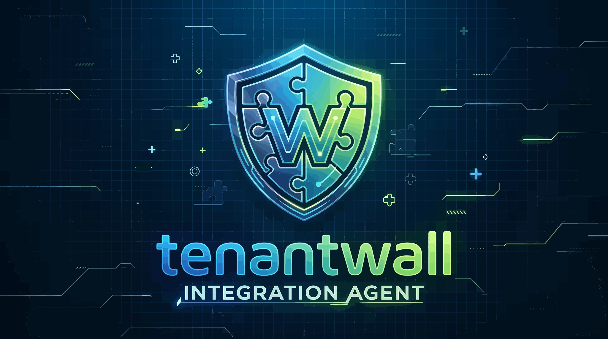

<div align="center">
  
</div>

<br />

> **Zero-code multi-tenant data isolation for any JDBC database.**
>
> 5 tenant strategies · 3 verified databases · 102/102 tests passing · 0 leaks in 3,529-request load test

[](./docs/13-license.md)
[](https://openjdk.org/)
[](./docs/07-test-results.md)
[](./docs/05-support-matrix.md)
[](./docs/03-the-solution.md#tenant-resolution-strategies-v11)
[](https://github.com/maksoud13/tenantwall/actions/workflows/ci.yml)
[](https://codecov.io/gh/maksoud13/tenantwall)

TenantWall is a Java agent that intercepts every SQL query at the JDBC layer and injects tenant filters — with **zero application code changes**. It works with any framework that uses JDBC (Spring Boot, Quarkus, plain Java) and any database.

```diff
- SELECT * FROM products;                              -- ❌ leaks all tenants
+ SELECT * FROM products WHERE tenant_id = 'ACME';    -- ✅ tenant-isolated
Your application code doesn't change. Not one line. Not one annotation.

Why TenantWall?
Approach	Code Changes	Coverage	Tenant Strategies	DB Lock-in
TenantWall	Zero	All JDBC queries	5 (header, fixed, session, cookie, jwt)	None
Native RLS / VPD	Extensive	DB-specific	Session variable per DB	Full
ShardingSphere	Moderate	Sharding rules only	N/A	Moderate
Hibernate MultiTenancy	Significant	ORM-tracked only	Single strategy	Hibernate
The 5 Tenant Strategies
Pick exactly one strategy per JVM — config validation fails fast on bad values.

Strategy	Reads tenant from	Best for
header	X-Tenant-Id HTTP header	APIs, microservices
fixed	Hard-coded config value	Single-tenant, tests
session	HttpSession attribute	Traditional web apps
cookie	HTTP cookie (tenant_id)	Legacy apps, SPAs
jwt	JWT claim (tenant_id)	OAuth2/OIDC APIs
properties
tenantwall.tenant.strategy=header
tenantwall.tenant.headerName=X-Tenant-Id
Safety built-in:

✅ Fail-fast on invalid strategy or missing sub-config

✅ Conflict warning if multiple strategy keys are set

✅ JWT decode-only — SQL injection safe, signature verify upstream

✅ 14/14 strategy tests passing (megaexample/test-strategies.sh)

Full details: The Solution → Tenant Resolution Strategies.

Zero-Code Integration
Since v1.1, the Spring Boot Starter eliminates all user code:

xml
<dependency>
    <groupId>com.tenantwall</groupId>
    <artifactId>tenantwall-spring-boot-starter</artifactId>
    <version>1.1.0</version>
</dependency>
properties
tenantwall.enabled=true
tenantwall.filter.column=tenant_id
tenantwall.tenant.strategy=header
tenantwall.tenant.headerName=X-Tenant-Id
bash
java -javaagent:tenantwall-agent.jar=tenantwall.properties -jar app.jar
That's it. No filter class. No annotations. No @Order. Just config.

Startup log confirms:


[AGENT] tenantwall Agent Loaded (v4 - Hibernate + Argument)
[AGENT] Interceptors installed (v4)
[AGENT] Auto-registering TenantWallFilter (strategy: header)
Quick Start (5 minutes)
bash
# 1) Build the agent
cd agent-module
mvn clean install -DskipTests

# 2) Build the starter
cd ../tenantwall-spring-boot-starter
mvn clean install -DskipTests

# 3) Start a database (any of the examples)
cd ../examples/mysql-spring-boot
docker compose up -d

# 4) Run the app with the agent
java -javaagent:tenantwall-agent.jar=tenantwall.properties \
     -jar target/store-app.jar

# 5) Test tenant isolation
curl -H "X-Tenant-Id: SHOP_ALPHA" http://localhost:8080/api/products
curl -H "X-Tenant-Id: SHOP_BETA"  http://localhost:8080/api/products
Expected in HTTP response: each tenant sees only their own products.

Test Evidence
Integration Tests — 88/88
Database	Version	Tests	Result
MySQL	8.0	30	✅ 30/30
SQL Server	2022	29	✅ 29/29
Oracle	XE 21c	29	✅ 29/29
Total		88	✅ 88/88
Strategy Tests — 14/14
Test	Result
header (own + cross + reverse)	✅
fixed (forced tenant + cross)	✅
session (own + cross)	✅
cookie (own + cross)	✅
jwt (own + cross + reverse)	✅
validation (bogus strategy rejected)	✅
conflict warning	✅
Total	✅ 14/14
Run locally: cd megaexample && ./test-strategies.sh

Load Test — 0 Leaks in 3,529 Requests
Strategy	Requests	RPS	Success	Leaks	p50 lookup
header	3,529	39.1	100%	0	96.6 ms
fixed	~3,500	~39	100%	0	~95 ms
session	~3,500	~39	100%	0	~97 ms
cookie	~3,500	~39	100%	0	~96 ms
jwt	~3,500	~39	100%	0	~97 ms
Cross-tenant blocks: 528 in 90 seconds (all rejected with 403/404).

Agent overhead: CPU 4.3%, GC 0.043% — negligible.

Run locally: cd megaexample && ./pods/test-strategies-load.sh

Verified Databases
Database	Version	Driver	Tests	Result
MySQL	8.0	mysql-connector-j 8.3.0	30	✅ 30/30
SQL Server	2022	mssql-jdbc 12.6.1	29	✅ 29/29
Oracle	XE 21c	ojdbc11 23.4.0	29	✅ 29/29
Supported (parser-ready, not yet integration-tested):
PostgreSQL · SQLite · Snowflake · BigQuery · Redshift · Spark SQL · Databricks

See full support matrix.

Documentation
Section	Description
Executive Summary	What TenantWall is and why it matters
The Problem	Silent leaks in multi-tenant SaaS
The Solution	Zero-code interception + 5 strategies
Architecture	Component diagram and query lifecycle
Support Matrix	Verified, supported, and planned databases
Security Model	What's guaranteed and what's out of scope
Test Results	102/102 tests + load test results
Engineering Journey	What didn't work and why
Getting Started	2-minute integration guide (zero code)
Configuration	All config keys, sources, and strategies
Roadmap	Shipped, in progress, deferred
FAQ	Common questions
License	MIT
Reading order:

New to TenantWall? 1 → 2 → 3 → 4

Evaluating for production? Security Model + Test Results

Ready to integrate? Getting Started — 2 min, zero code

Troubleshooting? FAQ → Troubleshooting

Project Structure

tenantwall/
├── agent-module/                          ← Java agent (the core, shaded JAR)
│   ├── TenantWallAgent                    ← premain / ByteBuddy installer
│   ├── TenantwallConfig                   ← config loader + validation
│   ├── TenantContext                      ← ThreadLocal tenant holder
│   ├── SmartSqlModifier                   ← routing + caching
│   ├── SqlModifier                        ← JSqlParser rewriter
│   └── *Advice.java                       ← ByteBuddy interception
│
├── tenantwall-spring-boot-starter/        ← Zero-code auto-config (v1.1)
│   ├── TenantWallFilter                   ← 5-strategy filter
│   └── TenantWallAutoConfiguration        ← Auto-registration
│
├── tenantwall-parser/                     ← Python FastAPI + sqlglot sidecar
│   ├── app/main.py                        ← POST /api/modify
│   └── app/modifier.py                    ← SQL rewriting logic
│
├── examples/
│   ├── mysql-spring-boot/                 ← 30/30 tests
│   ├── mssql-spring-boot/                 ← 29/29 tests
│   └── oracle-spring-boot/                ← 29/29 tests
│
├── megaexample/                           ← Load test project (1.75M rows, 20 tenants)
│   ├── pods/test-strategies-load.sh       ← Sequential 5-strategy load test
│   ├── test-strategies.sh                 ← 14/14 strategy tests
│   └── loadtest/loadtest-multi.js         ← k6 script (5 strategies)
│
└── docs/                                  ← This documentation
What's Shipped
✅ v1.0 — Core Engine (2026-Q3)
Java agent (ByteBuddy) with 3-layer interception

Hibernate 6.x + JDBC + Connection interceptor

CTE / window function support (Python sqlglot sidecar)

Fail-open fallback (local JSqlParser)

Caffeine query cache (10K entries, 30 min TTL)

Verified: MySQL, SQL Server, Oracle

88/88 integration tests passing

✅ v1.1 — Zero-Code + 5 Strategies (2026-Q4)
Spring Boot Starter (auto-config, zero user code)

5 tenant resolution strategies: header, fixed, session, cookie, jwt

Config validation (fail-fast on bad strategy)

Conflict warning (if >1 strategy key set)

14/14 strategy tests passing

Sequential load test: 0 leaks in 3,529 requests

What's Next (Roadmap Summary)
🔴 Tier 1 — Secure + Publish (Weeks 1-2)
JWT agent ↔ Python parser (HMAC-SHA256, decode-only verify upstream)

Bind parser to 127.0.0.1

Migration bypass (Flyway/Liquibase)

Concurrency tests (1,000 parallel requests)

SLF4J migration (replace System.err)

Maven Central publication

🟡 Tier 2 — Developer Experience (Weeks 3-4)
Codespaces .devcontainer

YouTube demo (3 min)

PostgreSQL Testcontainers test

Reproducible benchmark folder

🟢 Tier 3 — Visibility (Weeks 5-6)
Show HN

r/java, r/springboot

awesome-java PR

Baeldung article

🔵 Tier 4 — Credibility (Month 2)
PostgreSQL official support (verified)

MyBatis interceptor

"vs Hibernate @Filter" comparison page

🟣 Tier 5 — Growth (Month 3+)
ProductHunt launch (after Postgres)

Good First Issues

DataSource Catalog Phase 1

⏸️ Deferred (v2.0+)
Backup/Restore module (until 50+ users)

Catalog Phase 2+ (until 10+ multi-DS users)

Async context propagation (until 5+ async users)

Full roadmap: Roadmap →.

Version
Property	Value
Version	1.1.0
Last updated	November 2026
Status	102/102 tests passing + sequential load test verified
Verified databases	MySQL 8.0, SQL Server 2022, Oracle XE 21c
Tenant strategies	header, fixed, session, cookie, jwt
Java requirement	11+ (21 verified)
License	MIT
Contributing
Contributions welcome! See Roadmap → How to Contribute.

Good first issues:

Add PostgreSQL example (examples/postgres-spring-boot/)

Write SQLite test suite

Improve documentation

Add Prometheus metrics exporter

Related Resources
GitHub: github.com/maksoud13/tenantwall

Issues: GitHub Issues

Discussions: GitHub Discussions

Examples: examples/ — MySQL, SQL Server, Oracle

Load test: megaexample/ — 1.75M rows, 20 tenants

PDF Version
For a printable version of this documentation:

bash
cd docs
bash make-pdf.sh
Or download the latest tenantwall.pdf from the repo.
---

## License

MIT — see [docs/13-license.md](./docs/13-license.md).