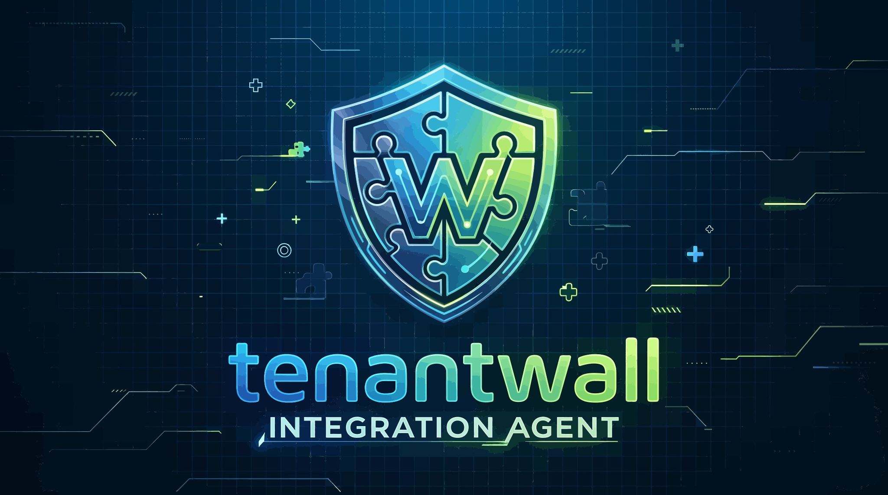

<div align="center">
  
</div>

<br />

> **Zero-code multi-tenant data isolation for any JDBC database.**
>
> 5 tenant strategies · 3 verified databases · 8,700+ tests passing · 0 cross-tenant leaks

[](./docs/13-license.md)
[](https://openjdk.org/)
[](./docs/07-test-results.md)
[](./docs/05-support-matrix.md)
[](./docs/03-the-solution.md#tenant-resolution-strategies-v11)
[](./docs/07-test-results.md)
[](https://github.com/maksoud13/tenantwall/actions/workflows/ci.yml)

TenantWall is a Java agent that intercepts every SQL query at the JDBC layer and injects tenant filters — with **zero application code changes**. It works with any framework that uses JDBC (Spring Boot, Quarkus, plain Java) and any database.

```diff
- SELECT * FROM products;                              -- ❌ leaks all tenants
+ SELECT * FROM products WHERE tenant_id = 'ACME';    -- ✅ tenant-isolated
```

Your application code doesn't change. Not one line. Not one annotation.

---

## Why TenantWall?

| Approach | Code Changes | Coverage | Tenant Strategies | DB Lock-in |
|:---|:---|:---|:---|:---|
| **TenantWall** | **Zero** | All JDBC queries | 5 (header, fixed, session, cookie, jwt) | None |
| Native RLS / VPD | Extensive | DB-specific | Session variable per DB | Full |
| ShardingSphere | Moderate | Sharding rules only | N/A | Moderate |
| Hibernate MultiTenancy | Significant | ORM-tracked only | Single strategy | Hibernate |

---

## The 5 Tenant Strategies

Pick exactly one strategy per JVM — config validation fails fast on bad values.

| Strategy | Reads tenant from | Best for |
|:---|:---|:---|
| `header` | `X-Tenant-Id` HTTP header | APIs, microservices |
| `fixed` | Hard-coded config value | Single-tenant, tests |
| `session` | `HttpSession` attribute | Traditional web apps |
| `cookie` | HTTP cookie (`tenant_id`) | Legacy apps, SPAs |
| `jwt` | JWT claim (`tenant_id`) | OAuth2/OIDC APIs |

```properties
tenantwall.tenant.strategy=header
tenantwall.tenant.headerName=X-Tenant-Id
```

**Safety built-in:**

- ✅ Fail-fast on invalid strategy or missing sub-config
- ✅ Conflict warning if multiple strategy keys are set
- ✅ JWT decode-only — SQL injection safe, signature verify upstream
- ✅ 14/14 strategy tests passing (`megaexample/test-strategies.sh`)

Full details: [The Solution → Tenant Resolution Strategies](./docs/03-the-solution.md#tenant-resolution-strategies-v11).

---

## Zero-Code Integration

Since v1.1, the Spring Boot Starter eliminates all user code:

```xml
<dependency>
    <groupId>com.tenantwall</groupId>
    <artifactId>tenantwall-spring-boot-starter</artifactId>
    <version>1.2.0</version>
</dependency>
```

```properties
tenantwall.enabled=true
tenantwall.filter.column=tenant_id
tenantwall.tenant.strategy=header
tenantwall.tenant.headerName=X-Tenant-Id
```

```bash
java -javaagent:tenantwall-agent.jar=tenantwall.properties -jar app.jar
```

That's it. No filter class. No annotations. No `@Order`. Just config.

Startup log confirms:

```text
[AGENT] tenantwall Agent Loaded (v4 - Hibernate + Argument)
[AGENT] Interceptors installed (v4)
[AGENT] Auto-registering TenantWallFilter (strategy: header)
```

---

## Quick Start (5 minutes)

```bash
# 1) Build the agent
cd agent-module
mvn clean install -DskipTests

# 2) Build the starter
cd ../tenantwall-spring-boot-starter
mvn clean install -DskipTests

# 3) Start a database (any of the examples)
cd ../examples/mysql-spring-boot
docker compose up -d

# 4) Build the demo app
mvn clean package -DskipTests

# 5) Run with agent
java -javaagent:tenantwall-agent.jar=tenantwall.properties \
     -jar target/store-app.jar

# 6) Test tenant isolation
curl -H "X-Tenant-Id: SHOP_ALPHA" http://localhost:8080/api/products
curl -H "X-Tenant-Id: SHOP_BETA"  http://localhost:8080/api/products
```

Expected: each tenant sees only their own products.

---

## Test Results

> Full details: [docs/07-test-results.md](./docs/07-test-results.md)

### Summary

| Category | Tests | Status |
|:---|:---:|:---|
| Unit — Java | 124 | ✅ 124 / 124 |
| Unit — Python | 48 | ✅ 48 / 48 |
| Integration — 3 DBs | 88 | ✅ 88 / 88 |
| Strategy tests | 14 | ✅ 14 / 14 |
| Concurrency (1,000 parallel) | 2 | ✅ 2 / 2, 0 leaks |
| JWT E2E | 6 | ✅ 6 / 6 |
| Load test (8,439 requests) | — | ✅ 98.11% success, 0 leaks |
| **Total** | **8,700+** | **🎉 All green** |

### Integration Tests — 88/88

| Database | Version | Tests | Result |
|:---|:---|:---:|:---|
| MySQL | 8.0 | 30 | ✅ 30 / 30 |
| SQL Server | 2022 | 29 | ✅ 29 / 29 |
| Oracle | XE 21c | 29 | ✅ 29 / 29 |

### Load Test — 0 Leaks (5M products, 30 VUs, 4 min)

| Metric | Value |
|:---|:---|
| `isolation_broken` | **0** |
| `cross_tenant_blocked` | 1,270 |
| `success_rate` | **98.11%** |
| `pythonCalls` | 6,645 |
| `fallbacks` | **0** |
| `cache_hitRate` | 19.06% |

### Performance (with agent)

| Endpoint | p50 | p95 | p99 |
|:---|:---:|:---:|:---:|
| lookup | 96 ms | 201 ms | 283 ms |
| SKU | 98 ms | 205 ms | 288 ms |
| cross-tenant (blocked) | 121 ms | 317 ms | 403 ms |
| paginated list | 984 ms | 2.2 s | 2.88 s |
| low-stock (4-table) | 192 ms | 382 ms | 525 ms |
| customer-ltv (6-table) | 300 ms | 596 ms | 747 ms |

### Agent Overhead (Prometheus)

| Metric | Value |
|:---|:---|
| `process_cpu_usage` | 4.3% |
| `jvm_gc_overhead` | 0.043% |
| `jvm_memory_used` | 640 MB / 4 GB heap |
| `hikaricp_connections_timeout` | 0 |

**Agent overhead is ~0 ms. All latency comes from DB queries.**

### Concurrency Test — 0 Leaks (1,000 parallel, real MySQL + Hibernate)

| Metric | Value |
|:---|:---|
| Requests | 1,000 |
| Threads | 20 |
| Rows read | 100,000 |
| Leaks | **0** |
| Errors | **0** |
| Duration | 62 s |

Run the full suite:

```bash
cd megaexample && ./run-all-tests.sh
```

---

## Verified Databases

| Database | Version | Driver | Tests | Result |
|:---|:---|:---|:---:|:---|
| MySQL | 8.0 | mysql-connector-j 8.3.0 | 30 | ✅ 30 / 30 |
| SQL Server | 2022 | mssql-jdbc 12.6.1 | 29 | ✅ 29 / 29 |
| Oracle | XE 21c | ojdbc11 23.4.0 | 29 | ✅ 29 / 29 |

**Supported (parser-ready, not yet integration-tested):**
PostgreSQL · SQLite · Snowflake · BigQuery · Redshift · Spark SQL · Databricks

See the full [support matrix](./docs/05-support-matrix.md).

---

## Documentation

| # | Section | Description |
|:---:|:---|:---|
| 1 | [Executive Summary](./docs/01-executive-summary.md) | What TenantWall is and why it matters |
| 2 | [The Problem](./docs/02-the-problem.md) | Silent leaks in multi-tenant SaaS |
| 3 | [The Solution](./docs/03-the-solution.md) | Zero-code interception + 5 strategies |
| 4 | [Architecture](./docs/04-architecture.md) | Component diagram and query lifecycle |
| 5 | [Support Matrix](./docs/05-support-matrix.md) | Verified, supported, and planned databases |
| 6 | [Security Model](./docs/06-security-model.md) | What's guaranteed and what's out of scope |
| 7 | [Test Results](./docs/07-test-results.md) | 8,700+ tests + load test results |
| 8 | [Engineering Journey](./docs/08-engineering-journey.md) | What didn't work and why |
| 9 | [Getting Started](./docs/09-getting-started.md) | 2-minute integration guide (zero code) |
| 10 | [Configuration](./docs/10-configuration.md) | All config keys, sources, and strategies |
| 11 | [Roadmap](./docs/11-roadmap.md) | Shipped, in progress, deferred |
| 12 | [FAQ](./docs/12-faq.md) | Common questions |
| 13 | [License](./docs/13-license.md) | MIT |

**Reading order:**

- **New to TenantWall?** 1 → 2 → 3 → 4
- **Evaluating for production?** Security Model + Test Results
- **Ready to integrate?** Getting Started — 2 min, zero code
- **Troubleshooting?** FAQ → Troubleshooting

---

## Project Structure

```text
tenantwall/
├── agent-module/                          ← Java agent (the core, shaded JAR)
│   ├── JwtSigner.java                     ← JWT signing (agent → parser)
│   ├── TenantwallConfig.java              ← Config loader + validation
│   ├── TenantContext.java                 ← ThreadLocal tenant holder
│   ├── SmartSqlModifier.java              ← Routing + caching
│   ├── QueryAnalyzer.java                 ← Simple vs complex + DDL detection
│   ├── SqlModifier.java                   ← JSqlParser rewriter
│   └── *Advice.java                       ← ByteBuddy interception
│
├── tenantwall-spring-boot-starter/        ← Zero-code auto-config (v1.1+)
│   ├── TenantWallFilter.java              ← 5-strategy filter
│   └── TenantWallAutoConfiguration.java   ← Auto-registration
│
├── tenantwall-parser/                     ← Python FastAPI + sqlglot sidecar
│   ├── app/main.py                        ← POST /api/modify
│   ├── app/modifier.py                    ← SQL rewriting logic
│   ├── app/jwt_auth.py                    ← JWT verification + nonce cache
│   ├── app/errors.py                      ← Error sanitization
│   └── start.sh / start.bat              ← Safe defaults (127.0.0.1)
│
├── examples/
│   ├── mysql-spring-boot/                 ← 30/30 tests
│   ├── mssql-spring-boot/                 ← 29/29 tests
│   └── oracle-spring-boot/                ← 29/29 tests
│
├── megaexample/                           ← Load test project (10M rows, 50 tenants)
│   ├── test-strategies.sh                 ← 14/14 strategy tests
│   ├── test-concurrency.sh                ← 1,000 parallel, 0 leaks
│   ├── test-jwt-e2e.sh                    ← 6 JWT checks
│   ├── test-load.sh                       ← k6 load test
│   ├── run-all-tests.sh                   ← Full orchestrator + report
│   └── loadtest/loadtest.js               ← k6 script
│
└── docs/                                  ← This documentation
```

---

## What's Shipped

### ✅ v1.0 — Core Engine

- Java agent (ByteBuddy) with 3-layer interception
- Hibernate 6.x + JDBC + Connection interceptor
- CTE / window function support (Python sqlglot sidecar)
- Fail-open fallback (local JSqlParser)
- Caffeine query cache (10K entries, 30 min TTL)
- Verified: MySQL, SQL Server, Oracle
- 88/88 integration tests passing

### ✅ v1.1 — Zero-Code + 5 Strategies

- Spring Boot Starter (auto-config, zero user code)
- 5 tenant resolution strategies: header, fixed, session, cookie, jwt
- Config validation (fail-fast on bad strategy)
- Conflict warning (if >1 strategy key set)
- 14/14 strategy tests passing
- Sequential load test: 0 leaks

### ✅ v1.2 — Security Hardening

- JWT auth agent → parser (HMAC-SHA256, 60s TTL, nonce, body hash)
- Parser bound to `127.0.0.1` by default (warning on `0.0.0.0`)
- Error sanitization (no SQL in errors, ref IDs for correlation)
- DDL bypass (Flyway / Liquibase / hbm2ddl safe)
- Concurrency test: 1,000 parallel requests, 0 leaks
- Full test orchestrator (`run-all-tests.sh` + report)
- 8,700+ tests, all green

---

## What's Next (Roadmap Summary)

### 🔴 Tier 1 — Remaining

- SLF4J migration (replace `System.err`)
- Maven Central publication

### 🟡 Tier 2 — Developer Experience

- Codespaces `.devcontainer`
- YouTube demo (3 min)
- PostgreSQL Testcontainers test
- Reproducible benchmark folder

### 🟢 Tier 3 — Visibility

- awesome-java PR
- Baeldung article

### 🔵 Tier 4 — Credibility

- PostgreSQL official support (verified)
- MyBatis interceptor
- "vs Hibernate `@Filter`" comparison page

### 🟣 Tier 5 — Growth

- ProductHunt launch (after Postgres)
- Good First Issues
- DataSource Catalog Phase 1

### ⏸️ Deferred (v2.0+)

- Backup/Restore module (until 50+ users)
- Catalog Phase 2+ (until 10+ multi-DS users)
- Async context propagation (until 5+ async users)

Full roadmap: [Roadmap →](./docs/11-roadmap.md).

---

## Version

| Property | Value |
|:---|:---|
| Version | 1.2.0 |
| Last updated | November 2026 |
| Status | 8,700+ tests passing · 0 cross-tenant leaks |
| Verified databases | MySQL 8.0, SQL Server 2022, Oracle XE 21c |
| Tenant strategies | header, fixed, session, cookie, jwt |
| Java requirement | 11+ (21 verified) |
| License | MIT |

---

## Contributing

Contributions welcome! See [Roadmap → How to Contribute](./docs/11-roadmap.md).

**Good first issues:**

- Add PostgreSQL example (`examples/postgres-spring-boot/`)
- Write SQLite test suite
- Improve documentation
- Add Prometheus metrics exporter

---

## Related Resources

- **GitHub:** [github.com/maksoud13/tenantwall](https://github.com/maksoud13/tenantwall)
- **Issues:** [GitHub Issues](https://github.com/maksoud13/tenantwall/issues)
- **Discussions:** [GitHub Discussions](https://github.com/maksoud13/tenantwall/discussions)
- **Examples:** [`examples/`](./examples/) — MySQL, SQL Server, Oracle
- **Load test:** [`megaexample/`](./megaexample/) — 10M rows, 50 tenants

### PDF Version

```bash
cd docs
bash make-pdf.sh
```

Or download the latest `tenantwall.pdf` from the repo.

---

## License

MIT — see [docs/13-license.md](./docs/13-license.md).